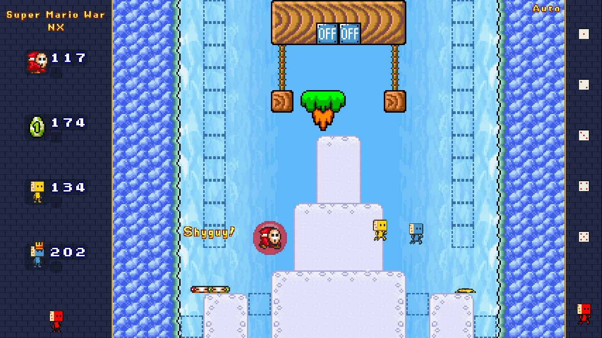

# Super Mario War NX

A native Nintendo Switch port of [Super Mario War](https://github.com/mmatyas/supermariowar), the fan-made multiplayer Super Mario Bros. deathmatch game. It runs as an **NRO** from the Homebrew Menu, with an optional forwarder **NSP** that gives it its own HOME menu icon.



- Up to **8 players** on one console: Joy-Con pairs, single sideways Joy-Cons, Pro Controllers or handheld mode, in any mix
- All 22 game modes, tournaments, tours, world maps and the bundled maps, skins, music and sound packs
- 60 fps, rendered at the console's output resolution (720p handheld, 1080p docked) with the 640x480 game scaled pixel-sharp
- Fills the 16:9 screen with side panels: the score boxes, lives and stored items move to a panel on the left, so the whole arena is free
- Extra character: **Rollie**, the mascot of [Sip n Play](https://sipnplay.cafe), a board game cafe in Saigon
- Settings, screenshots and map caches are saved on the SD card in `sdmc:/switch/supermariowar/`

This repository follows the upstream game. The Switch-specific code lives in `platform/switch/`, `cmake/PlatformSwitch.cmake` and `src/smw/platform/switch/`, and the fixes that also apply to other platforms are kept small so they can go upstream.

## Widescreen development build

The `eight-players` branch includes 23 approved converted stages plus **0smw Wide**.
With 2–4 enabled players, the stage picker and Quick Game use the original maps;
with 5–8, they use only the 24 widescreen maps. All eight slots support physical
controllers. Player 1 controls player setup, stage selection and Quick Start;
each player chooses their own fighter with L/R, colour with ZL/ZR and confirms
with A. Tours, worlds and minigames remain limited to four players because their
scripted maps have not been widened.

The maps and selection logic are shared with PC builds. This pack has passed PC
sanitizer gameplay checks and a Toad hardware smoke test at 4, 5 and 8 players.
The forwarder exit crash is fixed. A public eight-controller hardware test is the
remaining gate before release. Authoring and validation details: [widescreen pack](tools/widescreen/README.md).

## Installing

You need a Switch running custom firmware (Atmosphère). Download the files from the [latest release](../../releases/latest).

- **NRO + forwarder NSP** (recommended): extract `SuperMarioWar-NX-v*.zip` to the root of your SD card (it puts `smw.nro` in `sdmc:/switch/supermariowar/`), then install `SuperMarioWar-NX-v*-forwarder.nsp` with an installer such as DBI, Tinfoil or Awoo for a HOME menu icon. The title ID is `017397C52C004000`. Installing NSPs requires signature patches that match your firmware.
- **NRO only**: copy `smw.nro` to `sdmc:/switch/supermariowar/` and start it from the Homebrew Menu (use title override, not the Album, for full memory).

A standalone NSP (`platform/switch/nsp/build-nsp.sh`) also builds, but it currently crashes Atmosphère's fatal module on launch on real hardware, so don't install it until that is fixed.

## Controls

Each controller slot is one player: the first controller (or the console in handheld mode) is player 1, and so on. Connect and order controllers from the HOME menu's *Controllers* screen.

| Action | Pro Controller / Joy-Con pair | Single sideways Joy-Con |
|---|---|---|
| Move | D-pad or left stick | Stick |
| Jump | A or B | A/B position buttons |
| Run / fire | Y or X | X/Y position buttons |
| Use stored power-up | L, R, ZL or ZR | SL or SR |
| Pause | + | Stick click |
| Exit match | − | + or − |
| Menu select / back | A / B | A / B positions |

Controls can be remapped per player in *Controls* on the main menu.

## Not included (yet)

- Online multiplayer (netplay is compiled out; local multiplayer only)
- The level editor and world editor (keyboard-and-mouse tools)

## Building

Everything builds in the official devkitPro Docker image, so you only need Docker.

```sh
git clone --recurse-submodules https://github.com/brendongl/supermariowar-nx
cd supermariowar-nx
docker run --rm -u "$(id -u):$(id -g)" -e HOME=/tmp -v "$PWD":/src -w /src \
    devkitpro/devkita64 platform/switch/build.sh
```

This builds the SDL 3 stack for the Switch once (`platform/switch/build-deps.sh`, see below) and then produces `build-switch/src/smw/smw.nro`.

To package the forwarder NSP you also need [hacPack](https://github.com/DarkMatterCore/hacPack), the forwarder assets from [NTON](https://github.com/rlaphoenix/nton) and the keys dumped from your own console:

```sh
HACPACK=/path/to/hacpack NTON_ASSETS=/path/to/nton/nton/assets PROD_KEYS=~/.switch/prod.keys \
    platform/switch/nsp/build-forwarder.sh
```

### SDL 3 on the Switch

Upstream moved to SDL 3, and devkitPro currently ships only SDL 2 packages for the Switch. `build-deps.sh` builds [sdl3-nx](https://github.com/nx-mod/sdl3-nx) (SDL 3.4.18 with devkitPro's Switch backend) plus SDL3_image and SDL3_mixer, and applies `platform/switch/patches/sdl3-static-egl.patch` so the GLES renderer can use the statically linked Mesa EGL.

## Testing

`SMW_AUTOTEST` (on by default for Switch builds) compiles in an unattended soak test. Create an empty file named `autotest` in `sdmc:/switch/supermariowar/` and launch the game: four CPU players play random Quick Games (random mode, goal, settings and map) until you close it. Every match, warning and a heartbeat (frame rate, plus milliseconds spent updating/drawing and presenting) go to `sdmc:/switch/supermariowar/smw.log`. Optional lines in the file: `fast` turns off the frame limiter, `map=<file name without .map>` plays only that map (for comparing performance between builds), `skin=<name>` gives every player that character (e.g. `skin=Rollie`), and `players=<2-8>` sets the number of CPU players (more than 4 each get their own team and a random character). Delete the file to play normally.

The same tree also builds on Linux with AddressSanitizer and UndefinedBehaviorSanitizer for fast headless soaks. See [CONTRIBUTING.md](CONTRIBUTING.md).

## Roadmap

Planned features (player accounts and stats via QR code, tournaments, online play in the browser, widescreen stages) are in [ROADMAP.md](ROADMAP.md).

## Reporting problems

Please [open an issue](../../issues/new/choose) and attach `sdmc:/switch/supermariowar/smw.log` (and `smw.prev.log` if the game crashed and you relaunched it). Say whether you used the NSP or the NRO, your firmware and Atmosphère versions, docked or handheld, and which controllers were connected.

## Credits and license

Super Mario War is by the 72dpiarmy community and contributors, and the current upstream is maintained by Mátyás Mustoha ([mmatyas/supermariowar](https://github.com/mmatyas/supermariowar)). See [CREDITS](CREDITS) and the [upstream README](docs/README-upstream.md). The Switch port uses [devkitPro](https://devkitpro.org)'s toolchain and libnx, [sdl3-nx](https://github.com/nx-mod/sdl3-nx), and SDL by Sam Lantinga and the SDL contributors.

The Switch port is provided under the same terms as the upstream game. This is a non-commercial fan project and is not affiliated with Nintendo.

---

<sub>This Switch port was vibe-coded by the owner of [Sip n Play](https://sipnplay.cafe), a board game and video game cafe in Ho Chi Minh City (Saigon), Vietnam. If you're ever in town, come visit and say hi to Rollie!</sub>
